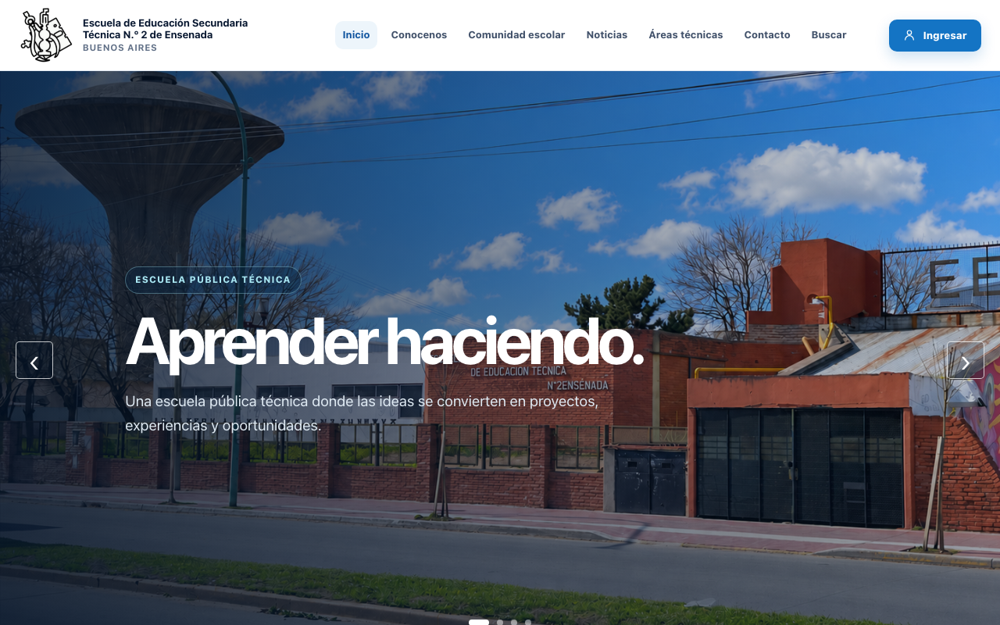

# Plataforma institucional · EEST N.º 2 de Ensenada

Proyecto del año 2026 de la **Escuela de Educación Secundaria Técnica N.º 2 de Ensenada** (Buenos Aires): un sitio web institucional y una API para gestionar comunicados, materiales y usuarios con distintos permisos.

> **Proyecto en equipo.** Este repositorio es una vitrina de mi participación. El código completo vive en el repositorio del equipo.

  

## Qué incluye

**Sitio web (frontend)**
- Página institucional responsive: inicio, novedades, comunidad escolar, áreas técnicas, galería, contacto y buscador.
- Navegación SPA con rutas y vistas separadas.
- Inicio de sesión y panel privado según el rol del usuario.
- Activación de cuenta y recuperación de contraseña.

**API (backend)**
- Autenticación con JWT y envío de correos.
- Cuatro roles (Administración, Jefatura, Docente y Superadmin) con permisos distintos: cada cual ve y gestiona lo que le corresponde.
- Comunicados y materiales dirigidos por departamento.
- Registro de movimientos (quién cambió qué).
- Base de datos con migraciones y pruebas automáticas.

## Tecnologías

| Parte | Tecnologías |
|---|---|
| Frontend | TypeScript, Vite, HTML y CSS |
| Backend | Python, Flask, SQLAlchemy, Flask-Migrate, Flask-JWT-Extended, Flask-Mail |
| Herramientas | Git y GitHub, Postman, Vercel |

## Mi participación

- Participé en el desarrollo de la **API** y en el **frontend** del proyecto.
- Trabajo en equipo con Git: ramas, revisión de cambios y resolución de conflictos.

## Repositorios del equipo

- API: _enlace cuando el repositorio sea público_
- Frontend: _enlace cuando el repositorio sea público_

## Autor

**Ignacio Giménez** · [LinkedIn](https://www.linkedin.com/in/ignaciogimenez7) · [GitHub](https://github.com/nachogimenez7)
